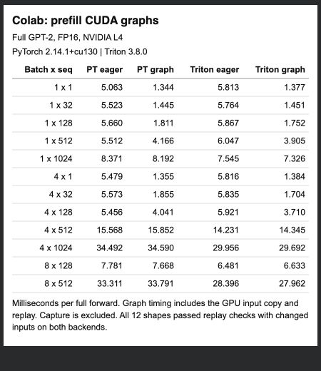
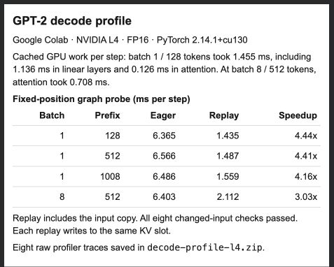
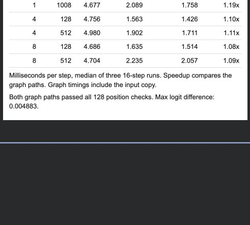

# GPT-2 with Triton

I started this project to learn how to write Triton kernels and use them in a GPT-2 forward pass. The model has 124,439,808 parameters. The kernels are in `kernels/`, and `model.py` has both the PyTorch and Triton paths so I can compare them with the same weights.

These experiments use random weights, FP16, and inference mode. They measure the full forward pass, including logits for every input position. The benchmark does not use a KV cache. A sequence length of 1 here means a one-token full forward pass. A PyTorch cached decode path is now included, but it is not part of the timing tables below.

## First version

I started with fixed matrix multiplication tiles: 32 rows, 64 output features, and 32 input features. The first version already combined token and position embeddings, the LayerNorm steps, linear bias with GELU or residual addition, and the attention steps.

The idea was to avoid extra intermediate tensors and kernel launches for the smaller operations, and use tiled matrix multiplication for the projections.

The first GPU check was slower than PyTorch. For batch 1 and sequence length 128, PyTorch took **4.214 ms** and Triton took **5.153 ms**. This was an initial check with 10 warmup calls and the average of 50 timed calls. I then tested more workloads instead of drawing a conclusion from that one shape.

## GPU used

- Google Colab, **NVIDIA L4**. I requested an A100, but Colab assigned an L4 because an A100 was unavailable.
- PyTorch `2.14.1+cu130`, Triton `3.8.0`, Python `3.13.16`.
- GPT-2: 12 layers, 12 heads, hidden size 768, vocabulary size 50,257.

All results below are from the L4. I have not tested these changes on an A100 yet.

## Tuning the linear kernel

In a profile of batch 1 and sequence length 128, the linear kernels accounted for **92.35% of GPU kernel time**. I started tuning there because that was where most of the measured GPU work was happening.

I added `triton.autotune` with eight configurations that change the tile sizes, number of warps, and pipeline stages. The search depends on the matrix dimensions and whether bias, GELU, or a residual is used.

The first autotuned version helped the larger workloads, but small workloads got slower. I added a small cache for the selected tile sizes and launch grid, so later calls can launch the selected kernel directly.

I reran the fixed version, tuned version, and PyTorch close together for this comparison. Times are in milliseconds. These are ordinary forward calls, without CUDA graphs.

| Batch | Sequence | PyTorch | Fixed Triton | Tuned Triton |
| --- | --- | --- | --- | --- |
| 1 | 1 | 5.099 | 5.724 | 5.737 |
| 1 | 32 | 5.310 | 5.784 | 5.674 |
| 1 | 128 | 5.330 | 5.835 | 5.661 |
| 1 | 512 | 5.234 | 5.840 | 5.740 |
| 1 | 1024 | 8.452 | 11.525 | 7.049 |
| 4 | 1 | 5.244 | 5.704 | 5.566 |
| 4 | 32 | 5.362 | 5.741 | 5.613 |
| 4 | 128 | 5.204 | 5.894 | 5.723 |
| 4 | 512 | 15.918 | 22.719 | 14.270 |
| 4 | 1024 | 35.285 | 46.419 | 30.346 |
| 8 | 128 | 7.965 | 10.941 | 6.752 |
| 8 | 512 | 34.351 | 45.477 | 28.981 |

For example, batch 1 and sequence length 1024 improved from 11.525 ms to 7.049 ms. That is about 1.64x faster than the fixed Triton version and 1.20x faster than PyTorch. Small workloads still favored PyTorch, so tile tuning did not solve everything.


## Trying CUDA graphs for prefill

Small workloads have less GPU work per launch. Python dispatch and launch overhead can then take a larger share of the forward time. I tried CUDA graphs to see how much of that overhead could be removed.

`cuda_graph.py` has one helper. It keeps a fixed input buffer, warms up on a side stream, and captures the forward pass. New tokens are copied into that buffer before replay. Each input shape gets its own capture in the benchmark.

I used graphs for both PyTorch and Triton. Graph times below include the GPU input-buffer copy and replay. They exclude capture and warmup. Times are in milliseconds.

| Batch | Sequence | PyTorch eager | PyTorch graph | Triton eager | Triton graph |
| --- | --- | --- | --- | --- | --- |
| 1 | 1 | 5.063 | 1.344 | 5.813 | 1.377 |
| 1 | 32 | 5.523 | 1.445 | 5.764 | 1.451 |
| 1 | 128 | 5.660 | 1.811 | 5.867 | 1.752 |
| 1 | 512 | 5.512 | 4.166 | 6.047 | 3.905 |
| 1 | 1024 | 8.371 | 8.192 | 7.545 | 7.326 |
| 4 | 1 | 5.479 | 1.355 | 5.816 | 1.384 |
| 4 | 32 | 5.573 | 1.855 | 5.835 | 1.704 |
| 4 | 128 | 5.456 | 4.041 | 5.921 | 3.710 |
| 4 | 512 | 15.568 | 15.852 | 14.231 | 14.345 |
| 4 | 1024 | 34.492 | 34.590 | 29.956 | 29.692 |
| 8 | 128 | 7.781 | 7.668 | 6.481 | 6.633 |
| 8 | 512 | 33.311 | 33.791 | 28.396 | 27.962 |

For batch 1 and sequence length 128, Triton went from 5.867 ms to 1.752 ms, about 3.35x faster with graphs. PyTorch also improved, from 5.660 ms to 1.811 ms. The difference between the two graph versions was small for this shape.

For larger workloads, graphs made much less difference and sometimes ran slightly slower. Capture plus warmup took about 27-140 ms in this experiment, so that setup cost also needs to be considered before using a graph for a one-off request.



## How I checked the numbers

- For the workload tables, I used 5 warmup calls, then 3 groups of 20 calls. Each group was timed with CUDA events and synchronization. The reported number is the median of the three group averages.
- Compilation, autotuning, capture, correctness checks, and input generation are outside the timed region. Inputs and outputs stay on the GPU.
- The PyTorch path uses PyTorch linear layers and scaled dot-product attention. It is not a naive attention baseline.
- Triton logits were compared with PyTorch using `atol=1e-2` and `rtol=1e-2` for FP16. All 12 workloads passed.
- Each graph was also replayed with two changed inputs and compared with its own eager backend using `atol=1e-3` and `rtol=1e-3`. These checks passed for both backends on all 12 shapes.
- The tuning and graph tables came from separate runs in the same Colab session. Small timing changes between runs are expected. These are full-forward measurements, not text-generation speed or A100 results.

## Run it

On a Colab GPU runtime:

```python
!git clone https://github.com/sudhirpol522/GPT2-Triton.git
%cd /content/GPT2-Triton
%pip install -q -r requirements.txt
!python benchmark.py
```

The first run will take longer because Triton compiles kernels and tries the tuning configurations. The script prints the GPU name, library versions, correctness results, and forward timings. It compares the current tuned implementation with PyTorch, with and without CUDA graphs. The fixed-tile version used in the earlier comparison is in commit `3de4fde`.

A small graph example:

```python
import torch
from model import GPT2
from cuda_graph import capture_prefill

model = GPT2(use_triton=True).cuda().half().eval()
input_ids = torch.randint(model.config.vocab_size, (1, 128), device="cuda")
graph, static_input, static_output = capture_prefill(model, input_ids)

new_input_ids = torch.randint(model.config.vocab_size, (1, 128), device="cuda")
static_input.copy_(new_input_ids)
graph.replay()
```

Keep the input and output buffers alive while using the graph. New inputs must use the captured shape, dtype, and device. `static_output` holds the latest result and is overwritten on the next replay. Use a new capture for a different shape. Warmup finishes Triton tuning before capture begins.

## PyTorch decode with a KV cache

I added a PyTorch decode path first so there is a reference to check a future Triton decode kernel against. `create_kv_cache` allocates keys and values once for every layer. The prompt fills the first positions, and each decode call writes one new position. Attention reads only the filled part of the cache.

```python
import torch
from model import GPT2

model = GPT2().eval()
prompt = torch.randint(model.config.vocab_size, (1, 8))

with torch.inference_mode():
    cache = model.create_kv_cache(batch_size=1, max_length=16)
    logits = model(prompt, kv_cache=cache)
    for _ in range(8):
        next_token = logits[:, -1].argmax(dim=-1, keepdim=True)
        logits = model.decode(next_token, cache)
```

Create the cache after moving the model to the intended device and dtype. Each batch uses equal-length prompts without padding, and decode takes one token per sequence. Create a new cache for a new batch or prompt. The prompt and decoded tokens together must fit within `max_length` and the model's context limit.

The eager reference uses a Python cache length and slices the filled prefix. The model still uses random weights. Run `python -m unittest test_decode.py` to check cached logits, greedy token choices, unchanged cache storage, and input validation against the full forward path. The CUDA graph test runs when an NVIDIA GPU is available.

I ran the cached decode path on the Colab NVIDIA L4 in FP16 with PyTorch `2.14.1+cu130`. Both paths project only the last token to logits. The uncached path reruns the transformer on the growing prefix. The table reports milliseconds per decode step, using the median of three 16-step runs after warmup. Prefill, cache allocation, and sampling are outside the measurement.

| Batch | Prompt tokens | Uncached | Cached | Uncached / cached |
| --- | --- | --- | --- | --- |
| 1 | 32 | 5.532 | 6.177 | 0.90x |
| 1 | 128 | 5.371 | 6.192 | 0.87x |
| 1 | 512 | 5.319 | 6.300 | 0.84x |
| 1 | 1008 | 5.490 | 6.411 | 0.86x |
| 4 | 128 | 5.498 | 6.469 | 0.85x |
| 4 | 512 | 10.933 | 6.732 | 1.62x |
| 8 | 128 | 5.478 | 6.486 | 0.84x |
| 8 | 512 | 24.604 | 6.509 | 3.78x |

All 128 decode steps passed the FP16 logit check (`atol=1e-2`, `rtol=1e-2`). The largest absolute difference was 0.004883. The key and value buffers kept the same addresses throughout decoding. A separate batch of two sequences produced the same greedy token choices for eight steps.

### Profiling decode on the L4

I profiled eight consecutive steps per workload with the [PyTorch profiler](https://docs.pytorch.org/docs/stable/profiler.html) on the same GPU and dtype. I collected a trace for each cached and uncached workload. I timed eager decode separately because profiling adds CPU overhead. The table shows GPU activity per cached step, in milliseconds.

| Batch | Prompt tokens | All GPU work | Linear layers | Attention | KV writes |
| --- | --- | --- | --- | --- | --- |
| 1 | 128 | 1.455 | 1.136 | 0.126 | 0.052 |
| 1 | 512 | 1.508 | 1.144 | 0.170 | 0.052 |
| 1 | 1008 | 1.580 | 1.148 | 0.239 | 0.052 |
| 8 | 512 | 2.047 | 1.144 | 0.708 | 0.052 |

At batch 1 and 128 prompt tokens, caching reduced active GPU work from 1.591 ms to 1.455 ms, while eager latency rose from 5.358 ms to 6.237 ms in this rerun. The cached step issued 150 GPU operations versus 138 uncached. The 24 KV copies together took about 0.052 ms on the GPU and 0.490 ms in their CPU profiler events. The CPU copy number includes profiler overhead. PyTorch picked FlashAttention in all eight traces.

I then captured a single cached decode step using a fixed position. Each replay changes the token and overwrites the same KV slot. The times below are the median of three runs of 20 steps after warmup. Replay includes the input copy. Two changed-input checks per shape passed against eager decode (`atol=1e-3`, `rtol=1e-3`).

| Batch | Cached prefix tokens | Eager (ms) | Graph replay (ms) | Speedup |
| --- | --- | --- | --- | --- |
| 1 | 128 | 6.365 | 1.435 | 4.44x |
| 1 | 512 | 6.566 | 1.487 | 4.41x |
| 1 | 1008 | 6.486 | 1.559 | 4.16x |
| 8 | 512 | 6.403 | 2.112 | 3.03x |

This suggested trying graph replay with a growing cache position first for small batches. Linear layers accounted for about 78% of GPU work at batch 1 and 128 tokens. Attention took a bigger share at batch 8 and 512 tokens, reaching about 35% of active GPU time. I used that larger shape to check whether a custom attention kernel helps.



[Download the L4 trace archive](assets/decode-profile-l4.zip) for the eight profiler traces and both sets of summary numbers. The public copy omits the Colab runtime hostname.

### CUDA graph decode with a growing cache

I kept the token and cache buffers at fixed addresses for replay. Each step writes to the slot given by a GPU position tensor, then increments that tensor as part of the graph. PyTorch SDPA gets a mask for the filled prefix. The Triton kernel uses one program per batch item and attention head. It reads the filled part of the cache in 64-token tiles and combines the dot products, softmax, and weighted sum of values. Both paths use the same PyTorch layers and cache writes.

I ran `python benchmark_decode.py` on the Colab NVIDIA L4 with PyTorch `2.14.1+cu130`, Triton `3.8.0`, and full GPT-2 in FP16. Each timed run processes 16 successive tokens after prefill. Numbers are milliseconds per step, using the median of three CUDA event measurements. The graph times include copying in each token and replaying the graph. Cache allocation, prefill, graph capture, and sampling are outside the timed loop.

| Batch | Prompt tokens | PyTorch eager | PyTorch graph | Triton attention graph | Graph speedup |
| --- | --- | --- | --- | --- | --- |
| 1 | 32 | 4.546 | 1.436 | 1.332 | 1.08x |
| 1 | 128 | 4.497 | 1.531 | 1.394 | 1.10x |
| 1 | 512 | 4.686 | 1.790 | 1.549 | 1.16x |
| 1 | 1008 | 4.677 | 2.089 | 1.758 | 1.19x |
| 4 | 128 | 4.756 | 1.563 | 1.426 | 1.10x |
| 4 | 512 | 4.980 | 1.902 | 1.711 | 1.11x |
| 8 | 128 | 4.686 | 1.635 | 1.514 | 1.08x |
| 8 | 512 | 4.704 | 2.235 | 2.057 | 1.09x |

Both graph paths matched eager decode at all 128 positions (`atol=1e-2`, `rtol=1e-2`). The largest absolute logit difference was 0.004883. The graph accounted for most of the latency drop. Switching attention to Triton gave a further 1.08x to 1.19x speedup over the PyTorch graph in this run. A repeat showed 1.08x to 1.20x. PyTorch selected its memory-efficient SDPA backend in spot checks at batch 1 with a 144-slot cache and batch 8 with a 528-slot cache.

After prefilling with PyTorch, capture one graph for the batch and its cache. Here `model` is `GPT2().cuda().half().eval()`, and `prompt` contains token IDs on the GPU.

```python
import torch

from cuda_graph import DecodeGraph

with torch.inference_mode():
    cache = model.create_kv_cache(prompt.shape[0], max_length=prompt.shape[1] + 16)
    logits = model(prompt, kv_cache=cache)
    decoder = DecodeGraph(model, cache, use_triton_attention=True)
    for _ in range(16):
        next_token = logits[:, -1].argmax(dim=-1, keepdim=True)
        logits = decoder.decode(next_token)
```

Each call updates the same cache and output buffers. Clone the output if you need to keep it after the next call. Capture a new graph for a new prompt or batch.


