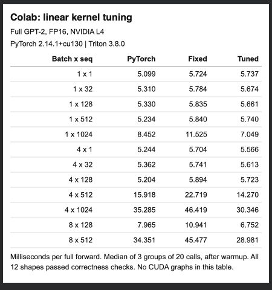

# GPT-2 with Triton

I started this project to learn how to write Triton kernels and use them in a GPT-2 forward pass. The model has 124,439,808 parameters. The kernels are in `kernels/`, and `model.py` has both the PyTorch and Triton paths so I can compare them with the same weights.

These experiments use random weights, FP16, and inference mode. They measure the full forward pass, including logits for every input position. There is no KV cache or cached decode path yet. A sequence length of 1 here means a one-token full forward pass.

## First version

I started with fixed matrix multiplication tiles: 32 rows, 64 output features, and 32 input features. The first version already combined token and position embeddings, the LayerNorm steps, linear bias with GELU or residual addition, and the attention steps.

The idea was to avoid extra intermediate tensors and kernel launches for the smaller operations, and use tiled matrix multiplication for the projections.

The first GPU check was slower than PyTorch. For batch 1 and sequence length 128, PyTorch took **4.214 ms** and Triton took **5.153 ms**. This was an initial check with 10 warmup calls and the average of 50 timed calls. I then tested more workloads instead of drawing a conclusion from that one shape.

## GPU used

- Google Colab, **NVIDIA L4**. I requested an A100, but Colab assigned an L4 because an A100 was unavailable.
- PyTorch `2.14.1+cu130`, Triton `3.8.0`, Python `3.13.16`.
- GPT-2: 12 layers, 12 heads, hidden size 768, vocabulary size 50,257.

All results below are from the L4. I have not tested these changes on an A100 yet.

## Tuning the linear kernel

In a profile of batch 1 and sequence length 128, the linear kernels accounted for **92.35% of GPU kernel time**. I started tuning there because that was where most of the measured GPU work was happening.

I added `triton.autotune` with eight configurations that change the tile sizes, number of warps, and pipeline stages. The search depends on the matrix dimensions and whether bias, GELU, or a residual is used.

The first autotuned version helped the larger workloads, but small workloads got slower. I added a small cache for the selected tile sizes and launch grid, so later calls can launch the selected kernel directly.

I reran the fixed version, tuned version, and PyTorch close together for this comparison. Times are in milliseconds. These are ordinary forward calls, without CUDA graphs.

| Batch | Sequence | PyTorch | Fixed Triton | Tuned Triton |
| --- | --- | --- | --- | --- |
| 1 | 1 | 5.099 | 5.724 | 5.737 |
| 1 | 32 | 5.310 | 5.784 | 5.674 |
| 1 | 128 | 5.330 | 5.835 | 5.661 |
| 1 | 512 | 5.234 | 5.840 | 5.740 |
| 1 | 1024 | 8.452 | 11.525 | 7.049 |
| 4 | 1 | 5.244 | 5.704 | 5.566 |
| 4 | 32 | 5.362 | 5.741 | 5.613 |
| 4 | 128 | 5.204 | 5.894 | 5.723 |
| 4 | 512 | 15.918 | 22.719 | 14.270 |
| 4 | 1024 | 35.285 | 46.419 | 30.346 |
| 8 | 128 | 7.965 | 10.941 | 6.752 |
| 8 | 512 | 34.351 | 45.477 | 28.981 |

For example, batch 1 and sequence length 1024 improved from 11.525 ms to 7.049 ms. That is about 1.64x faster than the fixed Triton version and 1.20x faster than PyTorch. Small workloads still favored PyTorch, so tile tuning did not solve everything.



## Trying CUDA graphs for prefill

Small workloads have less GPU work per launch. Python dispatch and launch overhead can then take a larger share of the forward time. I tried CUDA graphs to see how much of that overhead could be removed.

`cuda_graph.py` has one helper. It keeps a fixed input buffer, warms up on a side stream, and captures the forward pass. New tokens are copied into that buffer before replay. Each input shape gets its own capture in the benchmark.

I used graphs for both PyTorch and Triton. Graph times below include the GPU input-buffer copy and replay. They exclude capture and warmup. Times are in milliseconds.

| Batch | Sequence | PyTorch eager | PyTorch graph | Triton eager | Triton graph |
| --- | --- | --- | --- | --- | --- |
| 1 | 1 | 5.063 | 1.344 | 5.813 | 1.377 |
| 1 | 32 | 5.523 | 1.445 | 5.764 | 1.451 |
| 1 | 128 | 5.660 | 1.811 | 5.867 | 1.752 |
| 1 | 512 | 5.512 | 4.166 | 6.047 | 3.905 |
| 1 | 1024 | 8.371 | 8.192 | 7.545 | 7.326 |
| 4 | 1 | 5.479 | 1.355 | 5.816 | 1.384 |
| 4 | 32 | 5.573 | 1.855 | 5.835 | 1.704 |
| 4 | 128 | 5.456 | 4.041 | 5.921 | 3.710 |
| 4 | 512 | 15.568 | 15.852 | 14.231 | 14.345 |
| 4 | 1024 | 34.492 | 34.590 | 29.956 | 29.692 |
| 8 | 128 | 7.781 | 7.668 | 6.481 | 6.633 |
| 8 | 512 | 33.311 | 33.791 | 28.396 | 27.962 |

For batch 1 and sequence length 128, Triton went from 5.867 ms to 1.752 ms, about 3.35x faster with graphs. PyTorch also improved, from 5.660 ms to 1.811 ms. The difference between the two graph versions was small for this shape.

For larger workloads, graphs made much less difference and sometimes ran slightly slower. Capture plus warmup took about 27-140 ms in this experiment, so that setup cost also needs to be considered before using a graph for a one-off request.


## How I checked the numbers

- For the workload tables, I used 5 warmup calls, then 3 groups of 20 calls. Each group was timed with CUDA events and synchronization. The reported number is the median of the three group averages.
- Compilation, autotuning, capture, correctness checks, and input generation are outside the timed region. Inputs and outputs stay on the GPU.
- The PyTorch path uses PyTorch linear layers and scaled dot-product attention. It is not a naive attention baseline.
- Triton logits were compared with PyTorch using `atol=1e-2` and `rtol=1e-2` for FP16. All 12 workloads passed.
- Each graph was also replayed with two changed inputs and compared with its own eager backend using `atol=1e-3` and `rtol=1e-3`. These checks passed for both backends on all 12 shapes.
- The tuning and graph tables came from separate runs in the same Colab session. Small timing changes between runs are expected. These are full-forward measurements, not text-generation speed or A100 results.

## Run it

On a Colab GPU runtime:

```python
!git clone https://github.com/sudhirpol522/GPT2-Triton.git
%cd /content/GPT2-Triton
%pip install -q -r requirements.txt
!python benchmark.py
```

The first run will take longer because Triton compiles kernels and tries the tuning configurations. The script prints the GPU name, library versions, correctness results, and forward timings. It compares the current tuned implementation with PyTorch, with and without CUDA graphs. The fixed-tile version used in the earlier comparison is in commit `3de4fde`.

A small graph example:

```python
import torch
from model import GPT2
from cuda_graph import capture_prefill

model = GPT2(use_triton=True).cuda().half().eval()
input_ids = torch.randint(model.config.vocab_size, (1, 128), device="cuda")
graph, static_input, static_output = capture_prefill(model, input_ids)

new_input_ids = torch.randint(model.config.vocab_size, (1, 128), device="cuda")
static_input.copy_(new_input_ids)
graph.replay()
```

Keep the input and output buffers alive while using the graph. New inputs must use the captured shape, dtype, and device. `static_output` holds the latest result and is overwritten on the next replay. Use a new capture for a different shape. Warmup finishes Triton tuning before capture begins.
